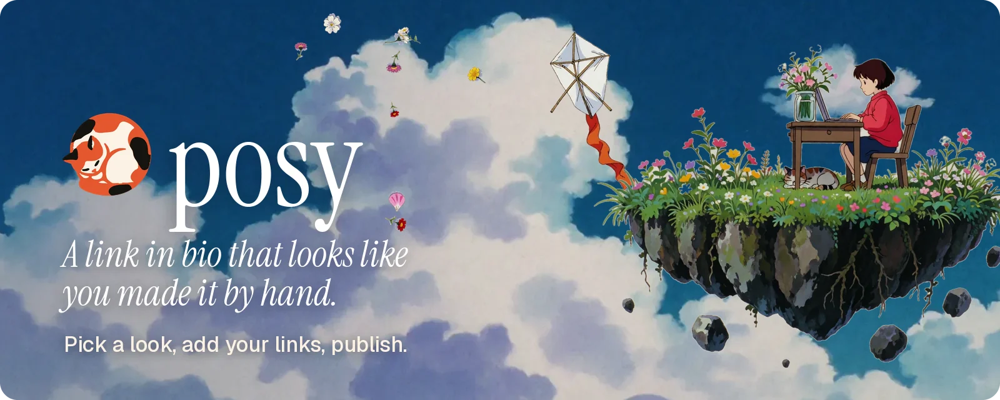
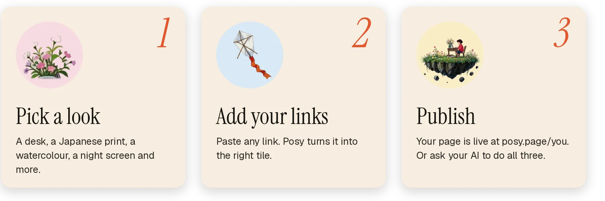
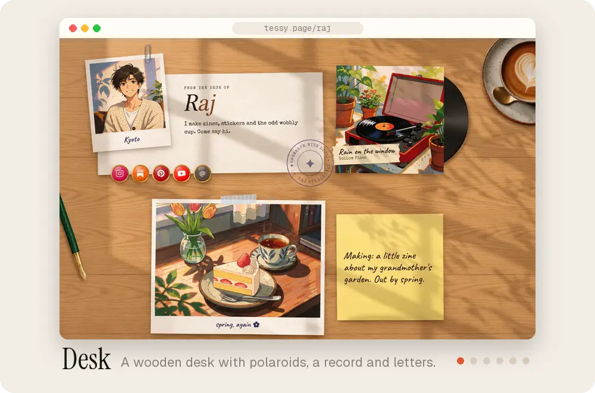
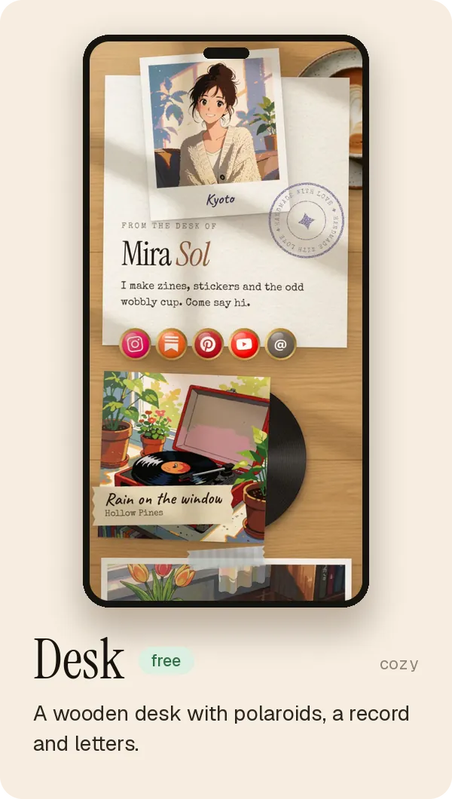
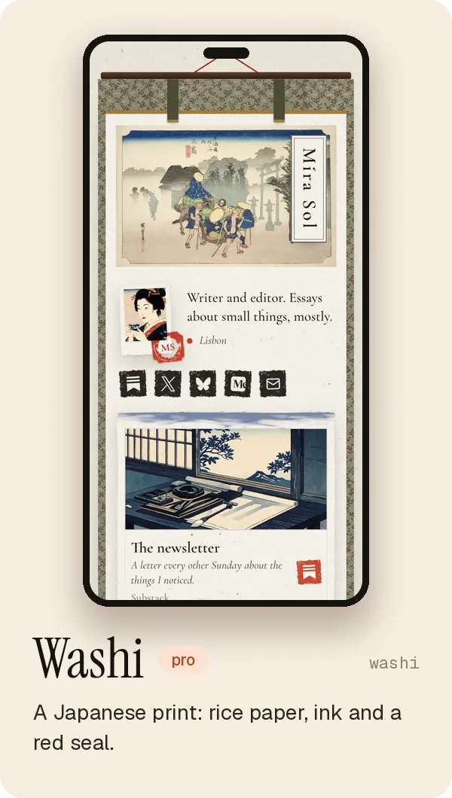
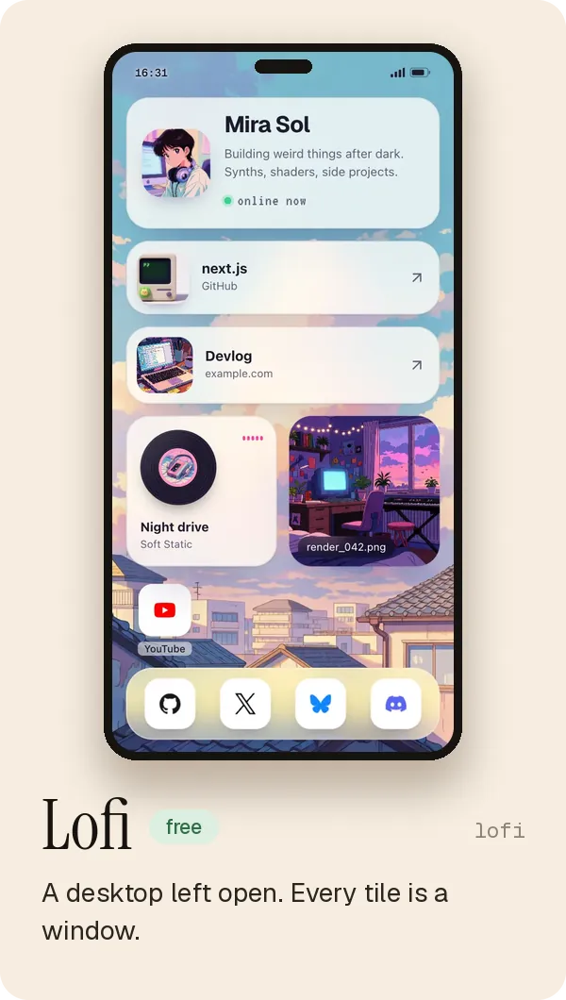
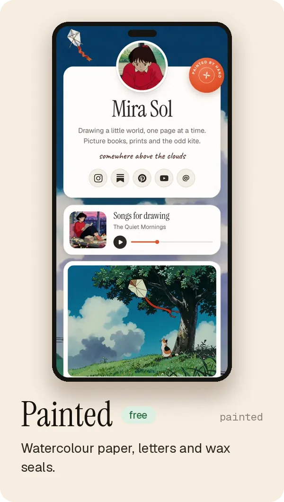
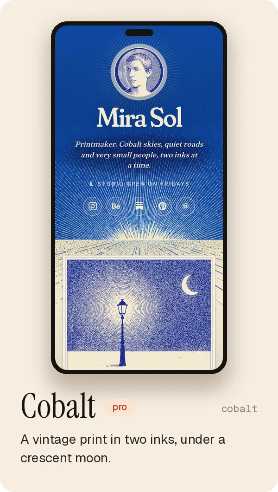
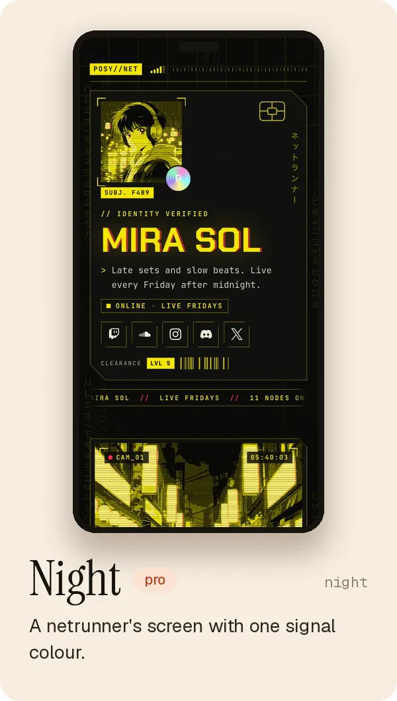
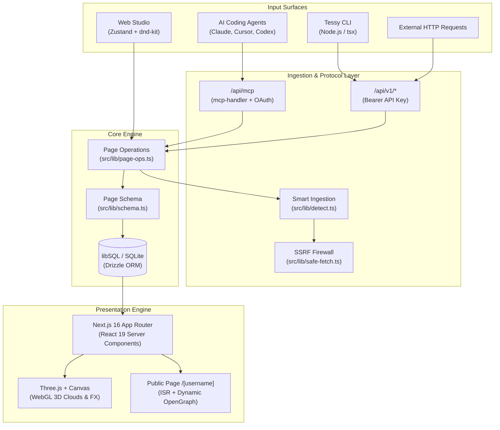

<p align="center">
  <a href="https://tessy.page">
    
  </a>
</p>

<h1 align="center">Tessy</h1>

<p align="center">
  <b>A link-in-bio page crafted by hand. Powered by AI.</b><br>
  Six dynamic rendering styles · Bento, list & canvas layouts · Hosted MCP server · Local-first JSON architecture.
</p>

<p align="center">
  <a href="https://github.com/codewithevilxd/tessy/actions/workflows/ci.yml"></a>
  <a href="CHANGELOG.md"></a>
  <a href="https://registry.modelcontextprotocol.io/v0.1/servers/io.github.codewithevilxd%2Ftessy/versions/latest"></a>
  <a href="https://nodejs.org"></a>
  <a href="LICENSE"></a>
  <a href="https://docs.tessy.page"></a>
  <a href="https://github.com/codewithevilxd/tessy/stargazers"></a>
</p>

<p align="center">
  <a href="https://tessy.page"><strong>Live App</strong></a> ·
  <a href="https://docs.tessy.page"><strong>Documentation</strong></a> ·
  <a href="#quickstart"><strong>Quickstart</strong></a> ·
  <a href="#connect-your-ai-mcp"><strong>AI & MCP</strong></a> ·
  <a href="#visual-styles"><strong>Visual Styles</strong></a> ·
  <a href="#architecture"><strong>Architecture</strong></a> ·
  <a href="#self-hosting"><strong>Self-Host</strong></a> ·
  <a href="#cli-reference"><strong>CLI</strong></a>
</p>

<p align="center">
  <a href="https://cursor.com/en/install-mcp?name=tessy&amp;config=eyJ1cmwiOiJodHRwczovL3Rlc3N5LnBhZ2UvYXBpL21jcCJ9"><picture><source media="(prefers-color-scheme: dark)" srcset=".github/assets/badges/cursor-dark.png"></picture></a>
  <a href="https://insiders.vscode.dev/redirect?url=vscode%3Amcp%2Finstall%3F%257B%2522name%2522%253A%2522tessy%2522%252C%2522type%2522%253A%2522http%2522%252C%2522url%2522%253A%2522https%253A%252F%252Ftessy.page%252Fapi%252Fmcp%2522%257D"><picture><source media="(prefers-color-scheme: dark)" srcset=".github/assets/badges/vscode-dark.png"></picture></a>
  <a href="https://claude.ai/customize/connectors?modal=add-custom-connector&amp;connectorName=Tessy&amp;connectorUrl=https%3A%2F%2Ftessy.page%2Fapi%2Fmcp"><picture><source media="(prefers-color-scheme: dark)" srcset=".github/assets/badges/claude-dark.png"></picture></a>
  <a href="https://goose-docs.ai/extension?type=streamable_http&amp;url=https%3A%2F%2Ftessy.page%2Fapi%2Fmcp&amp;id=tessy&amp;name=Tessy&amp;description=Make%20and%20edit%20your%20Tessy%20page"><picture><source media="(prefers-color-scheme: dark)" srcset=".github/assets/badges/goose-dark.png"></picture></a>
  <a href="https://docs.tessy.page/agents/connect#chatgpt"><picture><source media="(prefers-color-scheme: dark)" srcset=".github/assets/badges/chatgpt-dark.png"></picture></a>
</p>

<p align="center"></p>

## Overview

Tessy reimagines the link-in-bio page as an interactive digital artpiece. Instead of sterile rows of corporate buttons, links transform into tactile objects: polaroid photographs on a wooden desk, woodblock prints on rice paper, retro window panes beneath procedural WebGL clouds, or cybernetic HUD panels with real-time commit streams.

A Tessy page is governed by a single, portable, deterministic JSON document. You can build it in our visual studio, automate it with an AI assistant via the [Model Context Protocol (MCP)](https://modelcontextprotocol.io), control it from your terminal using the CLI, or export the raw JSON and host it anywhere.

```json
{
  "tessy": 1,
  "name": "Mira Sol",
  "bio": "Writer and editor.",
  "location": "Lisbon",
  "look": "washi",
  "links": [
    "https://substack.com/@mira",
    "https://x.com/mira",
    "hi@mira.so",
    { "heading": "Writing" },
    "https://mira.so/letters"
  ]
}
```

<picture>
  <source media="(prefers-color-scheme: dark)" srcset=".github/assets/how-dark.webp">
  
</picture>

---

## Key Features

- **6 Hand-Crafted Aesthetics**: Desk, Washi, Lofi, Painted, Cobalt, and Night. Each aesthetic features custom typography, bespoke textures, and dynamic ambient weather.
- **3 Dynamic Layout Engines**:
  - `bento`: Auto-packed geometric grid layout with variable tile footprints (`1x1`, `2x1`, `1x2`, `2x2`).
  - `list`: Single-column vertical stream optimized for quick mobile navigation.
  - `canvas`: Freeform 2D positioning coordinate space with variable rotation (`-15° to +15°`) and explicit z-indexing.
- **Smart Link Detection & Enriched Ingestion**: Paste any URL, email, or repository name. The detection engine automatically configures metadata, embeds, and icons:
  - 29 social platforms with official vector iconography.
  - Interactive Spotify album, track, and playlist embeds.
  - On-demand lazy-loaded YouTube video players.
  - Live GitHub repository cards displaying stars, description, and primary language.
  - Focal-point aware image cropping (`x, y: 0-100`) and photo filters (`natural`, `mono`, `dither`, `ascii`).
- **Autonomous AI & MCP Server**: Native Model Context Protocol endpoint (`/api/mcp`) supporting Claude Code, Cursor, ChatGPT, VS Code, and custom agent workflows.
- **Privacy-First Analytics**: Server-side view and click metrics without third-party trackers, cookies, or IP address persistence.
- **Enterprise-Grade SSRF Protection**: Strict socket-level IP validation, DNS rebinding prevention, and hop-by-hop redirect verification on all link preview unfurls.
- **Self-Hosting Freedom**: Everything unlocked. SQLite/Turso database, zero vendor lock-in, and custom domains out of the box.

---

## Quickstart

### 1. Hosted (Instant)

Open **[tessy.page/new](https://tessy.page/new)** to compose a page instantly in your browser without creating an account. Claim your username whenever you are ready to publish.

### 2. Local Development

Ensure **Node.js >= 20.9** (Node 22 or 24 recommended) and `npm` are installed:

```bash
# Clone the repository
git clone https://github.com/codewithevilxd/tessy.git
cd tessy

# Install dependencies (npm only)
npm install

# Start development server
npm run dev
```

Visit `http://localhost:3000`. Local SQLite data is stored in `~/.tessy` (configurable via `TESSY_DATA_DIR`).

### 3. Docker Deployment

```bash
docker build -t tessy .
docker run -p 3000:3000 \
  -v tessy-data:/data \
  -e NEXT_PUBLIC_SITE_URL=http://localhost:3000 \
  -e BETTER_AUTH_URL=http://localhost:3000 \
  -e BETTER_AUTH_SECRET=$(openssl rand -base64 32) \
  tessy
```

---

## Visual Styles

Each style draws the same underlying JSON data with an entirely unique visual personality, responsive mobile scene, and atmospheric effects.

<p align="center">
  <picture>
    <source media="(prefers-color-scheme: dark)" srcset=".github/assets/looks-tour-dark.webp">
    
  </picture>
</p>

| Look | Id | Aesthetic & Ambient Mechanics | Palettes |
|---|---|---|---|
| **Desk** | `cozy` | Wooden desk surface, polaroid photo cards, vinyl records, sticky notes, and animated procedural sunlight / leaf shadows. | Walnut, Maple, Pine, Teak |
| **Washi** | `washi` | Japanese woodblock print, handmade rice paper, sumi ink brush borders, and carved cinnabar red seal (*hanko*). | Rice, Matcha, Ink, Sakura |
| **Lofi** | `lofi` | Vintage desktop operating system. Little application windows with pinstriped titlebars, procedural WebGL 3D clouds by day, and rain over an anime skyline at night. | Terminal, Sunset, Vapor, Cyber |
| **Painted** | `painted` | Fine art paper with deckled edges, rough watercolor washes, hand-folded envelopes, and melted wax seal badges. | Parchment, Terracotta, Olive, Indigo |
| **Cobalt** | `cobalt` | Two-ink letterpress print. Rich midnight cobalt ink over cream stock, numbered astronomical plates, and solar burst insignias. | Deep Navy, Gold, Cream, Charcoal |
| **Night** | `night` | Cyberpunk HUD interface. Cut-corner telemetry panels, monochrome signal accent lasers, animated commit streams, and magnetic tape cassettes. | Phosphor, Amber, Cyan, Matrix |

<table>
  <tr>
    <td width="33%"><picture><source media="(prefers-color-scheme: dark)" srcset=".github/assets/phone-desk-dark.webp"></picture></td>
    <td width="33%"><picture><source media="(prefers-color-scheme: dark)" srcset=".github/assets/phone-washi-dark.webp"></picture></td>
    <td width="33%"><picture><source media="(prefers-color-scheme: dark)" srcset=".github/assets/phone-lofi-dark.webp"></picture></td>
  </tr>
  <tr>
    <td width="33%"><picture><source media="(prefers-color-scheme: dark)" srcset=".github/assets/phone-painted-dark.webp"></picture></td>
    <td width="33%"><picture><source media="(prefers-color-scheme: dark)" srcset=".github/assets/phone-cobalt-dark.webp"></picture></td>
    <td width="33%"><picture><source media="(prefers-color-scheme: dark)" srcset=".github/assets/phone-night-dark.webp"></picture></td>
  </tr>
</table>

---

## Architecture

Tessy is built on a unified pipeline where one Zod schema acts as the single source of truth across the web studio, REST API, CLI, and MCP servers.



### Technical Stack

| Layer | Technology | Purpose |
|---|---|---|
| **Framework** | [Next.js 16](https://nextjs.org) (App Router) + React 19 | Server Component rendering with minimal client island payloads |
| **Language** | TypeScript (Strict) | End-to-end type safety from schema to database |
| **Styling** | [Tailwind CSS v4](https://tailwindcss.com) + Isolated CSS Modules | Custom aesthetic skins, grain shaders, and responsive rules |
| **Motion & 3D** | Motion 14 + [Three.js](https://threejs.org) + Cobe | Micro-interactions, physics spring drag, and WebGL volumetric clouds |
| **Editor State** | [Zustand](https://zustand.docs.pmnd.rs) + [Zundo](https://github.com/charkour/zundo) + `@dnd-kit` | 100-step temporal undo/redo stack with optimistic drag-and-drop |
| **Database** | [Drizzle ORM](https://orm.drizzle.team) + `@libsql/client` | Local SQLite zero-config file or remote Turso distributed cluster |
| **Authentication** | [Better Auth](https://www.better-auth.com) | Email/password, OAuth (GitHub/Google), API keys, and MCP OAuth server |
| **Validation** | [Zod v4](https://zod.dev) | Single source of truth driving the JSON Schema, API, and MCP tools |
| **Testing** | [Vitest](https://vitest.dev) + [Playwright](https://playwright.dev) | 139+ passing unit test cases and end-to-end browser specs |

---

## Connect Your AI (MCP)

Tessy includes a production-ready, hosted Model Context Protocol server. AI assistants can manage your draft, add links, switch styles, and publish directly through conversational requests.

```text
https://tessy.page/api/mcp
```

### CLI / Terminal Integration

```bash
# Claude Code
claude mcp add --transport http tessy https://tessy.page/api/mcp
# Then run /mcp -> Authenticate in Claude Code

# Codex CLI
codex mcp add tessy --url https://tessy.page/api/mcp
```

### MCP Toolset Reference

| Tool | Action | Safety Hint |
|---|---|---|
| `get_page` | Returns the current draft, published URL, version, and pending diffs. | `readOnly` |
| `create_page` | Claims a username and initializes a new page with a selected look. | `idempotent` |
| `import_page` | Ingests a raw JSON page or conversational brief format. | `destructive` |
| `add_tile` | Ingests URLs, notes, markdown, emails, or headings with auto-detection. | `write` |
| `update_tile` | Modifies properties (title, crop, size, color) of an existing tile. | `idempotent` |
| `move_tile` | Reorders tile positions on the grid or list. | `idempotent` |
| `remove_tile` | Deletes a tile by ID. | `destructive` |
| `set_theme` | Configures style, layout (`bento`/`list`/`canvas`), preset, and fonts. | `idempotent` |
| `set_profile` | Updates name, bio, avatar URL, zoom, and location. | `idempotent` |
| `publish` | Deploys the draft to the live public URL and invalidates cache. | `openWorld` |
| `list_options` | Queries all available styles, palettes, fonts, and dimensions. | `readOnly` |

---

## CLI Reference

The built-in CLI (`scripts/tessy.ts`) gives you full programmatic control over your page:

```bash
# Setup environment
export TESSY_URL="http://localhost:3000"       # Or https://tessy.page
export TESSY_API_KEY="tessy_your_api_key_here"  # Generated in dashboard -> Agents

# Inspect current draft
npm run tessy -- get

# Add tiles
npm run tessy -- add https://github.com/facebook/react --size w
npm run tessy -- add "Check out my new article on systems architecture"
npm run tessy -- add hello@example.com

# Customize theme and typography
npm run tessy -- theme --preset lavender --font modern --layout list

# Update profile bio
npm run tessy -- profile --name "Mira Sol" --bio "Systems Architect & Writer"

# Publish draft to production
npm run tessy -- publish

# Schema validation
npm run tessy -- validate examples/creator.json
npm run tessy -- schema
```

---

## REST API & Public Endpoints

| Endpoint | Method | Auth | Description |
|---|---|---|---|
| `/api/v1/page` | `GET` | Bearer Key | Fetches current draft, state, and version index |
| `/api/v1/page` | `PUT` | Bearer Key | Replaces entire draft with concurrency control (`baseVersion`) |
| `/api/v1/page/tiles` | `POST` | Bearer Key | Appends single or batch tiles with auto-detection |
| `/api/v1/page/theme` | `PATCH` | Bearer Key | Updates theme style, layout, or background |
| `/api/v1/page/publish` | `POST` | Bearer Key | Commits draft to published state |
| `/api/v1/public/:username` | `GET` | None | Public JSON payload of any live published page |
| `/:username/llms.txt` | `GET` | None | Plaintext Markdown for LLM ingestion |
| `/openapi.json` | `GET` | None | OpenAPI 3.1 specification for client generators |
| `/schema/page.schema.json` | `GET` | None | Draft 2020-12 JSON Schema for validation |

---

## Self-Hosting

Deploy your own instance of Tessy on any Node host, Docker daemon, or Vercel serverless environment with 100% unlocked features (unlimited analytics, custom domains, zero branding).

### Environment Configuration

Copy `.env.example` to `.env`:

```bash
# Required Base URLs
NEXT_PUBLIC_SITE_URL="http://localhost:3000"
BETTER_AUTH_URL="http://localhost:3000"
BETTER_AUTH_SECRET="generate_a_random_32_byte_secret"

# Database (Leave blank for default local SQLite in ~/.tessy)
DATABASE_URL=""
DATABASE_AUTH_TOKEN=""

# Instance Control
TESSY_SIGNUP="first-user"   # 'first-user' (default), 'open', or 'closed'
TESSY_ROOT="marketing"      # 'marketing' (landing page) or 'app' (direct editor)
```

### Deploy to Vercel

[](https://vercel.com/new/clone?repository-url=https%3A%2F%2Fgithub.com%2Fcodewithevilxd%2Ftessy&env=BETTER_AUTH_SECRET,NEXT_PUBLIC_SITE_URL,BETTER_AUTH_URL,DATABASE_URL,DATABASE_AUTH_TOKEN&envDescription=Provide%20a%20Turso%20Database%20URL%20and%20Better%20Auth%20Secret)

---

## Directory Structure

```text
posy/
├── .github/             # GitHub Actions workflows, assets & issue templates
├── docs/                # Markdown documentation
│   ├── site/            # Mintlify documentation engine (docs.tessy.page)
│   └── *.md             # Single-source-of-truth markdown guides
├── examples/            # Validated starter JSON page templates
├── plugin/              # AI ecosystem plugins & manifests
│   ├── .claude-plugin/  # Claude Code plugin definition
│   ├── .cursor-plugin/  # Cursor plugin definition
│   ├── openai/          # ChatGPT app manifest and review assets
│   ├── gemini/          # Google Gemini CLI extension descriptor
│   ├── lhm/             # LM Studio model descriptor
│   └── skills/          # Portable agent skills (make-a-page)
├── public/              # Static media, look assets, and public/schema/
├── scripts/             # Tessy terminal CLI and documentation sync scripts
├── src/                 # Application source code
│   ├── app/             # Next.js 16 App Router (routes, public pages, API, MCP)
│   ├── components/      # React 19 UI library, Studio editor, and Look scenes
│   ├── db/              # Database schema, LibSQL client & migrations/
│   ├── edition/         # Feature flag matrix (self-hosted vs hosted)
│   └── lib/             # Core Zod schema, link detection, and security firewalls
└── tests/               # Vitest unit suites and Playwright E2E suites
```

---

## Quality Assurance & Testing

Before creating a pull request, run the complete verification suite:

```bash
# Type check + validate starter JSON templates
npm run check

# Execute all Vitest unit tests (139 tests)
npm test

# Run Playwright E2E browser automation (starts internal test server)
npm run e2e

# Production build verification
npm run build
```

---

## Community & Security

- **Contributing**: Please read [CONTRIBUTING.md](CONTRIBUTING.md) for contribution guidelines and steps to create a new Look.
- **Code of Conduct**: Tessy follows open, respectful community standards outlined in [CODE_OF_CONDUCT.md](CODE_OF_CONDUCT.md).
- **Security Vulnerabilities**: If you discover a vulnerability, please review [SECURITY.md](SECURITY.md) and report it responsibly.

---

## License

Tessy is licensed under the [MIT License](LICENSE).

Artwork included with the looks is public domain, CC0, or created specifically for Tessy. Full attributions and source archives are documented in [public/looks/CREDITS.md](public/looks/CREDITS.md).

<br>

<p align="center">
  <a href="https://tessy.page">
    
  </a>
</p>

<p align="center"><sub>Crafted by hand, with a cat asleep on the desk.</sub></p>
